# Aftman architecture — a deep dive for humans

This document explains how aftman works, end to end, for someone who wants to *understand* the
system rather than implement one corner of it. It is a guided tour across the numbered design
documents, with diagrams. It does not replace them: where this text and a numbered doc disagree,
the numbered doc (and ultimately the code) is the contract, and the disagreement is a bug to fix.

| If you want… | Read |
| --- | --- |
| The idea in one minute | [§1](#1-the-one-minute-version) |
| The vocabulary | [§2](#2-vocabulary) |
| How the code is laid out | [§3](#3-the-crates-and-how-they-depend-on-each-other) |
| What happens during a run | [§4](#4-the-life-of-a-run) and [§5](#5-one-supervision-cycle) |
| How a decision is actually made | [§7](#7-from-probabilities-to-proposals) and [§8](#8-policy-the-only-thing-that-decides) |
| Why it is safe to trust | [§9](#9-the-ensemble-honest-uncertainty) and [§13](#13-trust-boundaries-and-security) |
| Where to look next | [§16](#16-where-to-go-from-here) |

---

## 1. The one-minute version

Aftman is a **supervisor for coding agents**. You give it a repository and a free-form job
("add request retries with backoff and tests"). It starts a coding agent (`pi`, `agy`, `claude`,
or any command you give it) on that job. While the agent works, aftman keeps watching: it gathers
bounded evidence about the repository and the agent, asks a fast decision model (**Jev**) a set of
narrow yes/no questions, and then **deterministic Rust policy** decides what to do next:
continue, steer the agent, stop it, retry, run an independent verifier, finish, or ask a human.

Aftman never edits code. It also never interrupts the agent in order to think. The agent's loop
and aftman's loop run side by side:

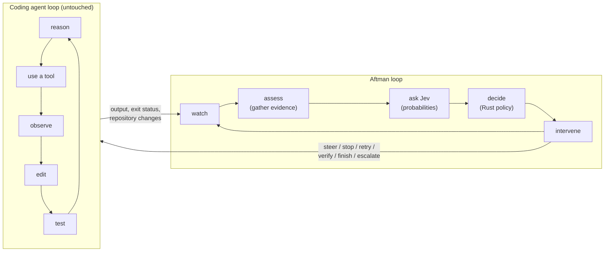

Everything aftman does is written to an append-only event log, so every decision can be
explained afterwards ("why didn't it stop?") and replayed offline. You can watch a run from three
places: the CLI/TUI, a local web UI, or (planned) herdr.

### The three invariants

If you remember nothing else:

1. **The model estimates; code decides.** A probability is never an action. Only `aftman-core`
   policy turns check results into a directive.
2. **The supervisor's credential is invisible to the worker.** The coding agent never sees the
   Jev API key, or any other `TYPESAFE_*` / `AFTMAN_*` variable.
3. **Uncertainty escalates, never accelerates.** When aftman is unsure, it does the more
   conservative thing: hold, re-measure, or ask a person. Uncertainty never makes it finish
   sooner.

Almost every design choice below follows from one of these three.

---

## 2. Vocabulary

| Term | Meaning |
| --- | --- |
| **Job** | The free-form task text plus the absolute repository path. |
| **Run** | One supervised attempt at a job. Identified by a time-ordered UUIDv7 `RunId`. |
| **Worker** | One coding-agent process (or herdr pane) doing work for a run. A run can have several over its life (coder, verifier, retry), but **only one at a time**. |
| **Verifier** | A worker with a fixed "try to falsify this, change nothing" mission. It runs on a different backend from the coder. |
| **Jev** | A "System One" decision model from TypeSafe: structured state and typed questions in, calibrated probabilities out. Reached only through `crates/aftman-jev`. |
| **Observation** | The bounded snapshot of everything aftman knows at a moment: job, worker output, git state, diffs, tests, recent events, counters. |
| **Evidence provider** | One source of observation content (`git_diff`, `worker_output`, …). `command:<id>` providers run a configured command, such as a test suite. |
| **Responsibility** | One area of supervision (`core.completion`, `core.worker-health`, …). It owns *checks* and *rules*. Defined in TOML. |
| **Check** | One question for Jev, such as `ready_to_finish`, with an optional threshold. Its wire key is `<responsibility>__<check>`. |
| **Rule** | "When this condition over check results holds, propose this directive." |
| **Proposal** | A directive a rule suggests, with a priority and stakes. Many proposals per cycle. |
| **Directive** | What actually happens next. Exactly one per cycle: `Continue`, `StartWorker`, `Steer`, `Retry`, `Verify`, `Stop`, `Finish`, `Escalate`. |
| **Policy** | Pure Rust arbitration: applies hard invariants, then picks the highest-priority surviving proposal. |
| **Ensemble** | The optional (off by default) layer that handles probabilities too close to a threshold, or too consequential to act on without a second look. |
| **Escalation** | A question put to a person. The run parks in `NeedsHuman` until someone answers. |
| **Cycle** | One pass of observe → ask → propose → arbitrate → act. |
| **Surface** | A client that shows runs to a person: CLI, TUI, web UI, herdr. |

---

## 3. The crates and how they depend on each other

Aftman is a Rust 2024 workspace of seven crates that builds one binary, `aftman`.
`aftman serve` runs the daemon. Every other subcommand is a client of the daemon, or, with
`--no-daemon`, of a runtime embedded in the CLI process.

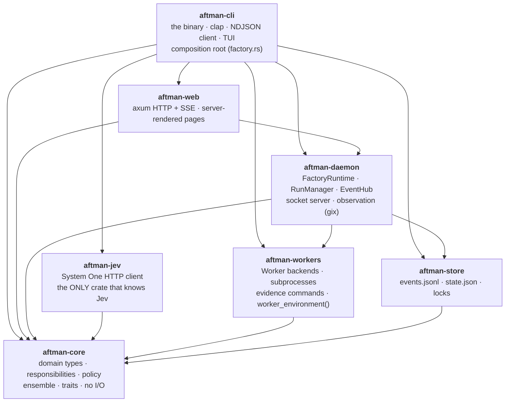

Dependencies only point downward. Note two things about the shape:

- **`aftman-core` depends on nothing in the workspace.** It holds the domain: types,
  responsibility definitions, the condition grammar, policy, and the ensemble algorithm. It
  defines the traits (`DecisionModel`, `Worker`, `RunStore`, `OpinionSource`, `Clock`) that the
  other crates implement. Policy lives here, and policy does no I/O.
- **The daemon does not know Jev, and it does not know the web.** `aftman-daemon` takes a
  `RuntimeFactory`. The real one is in `crates/aftman-cli/src/factory.rs`, the *composition root*,
  and it builds a `FactoryRuntime` with a `SystemOneClient` from `aftman-jev` behind
  `Arc<dyn DecisionModel>`. The web surface (`aftman-web`) depends on the daemon and calls the
  same `RunManager` methods the socket does. `aftman serve` mounts both. This keeps hard rule 2
  ("one module knows Jev") enforceable by the dependency graph itself.

| Crate | Owns | Never does |
| --- | --- | --- |
| `aftman-core` | Types, responsibilities, rules, policy, ensemble logic, test doubles | I/O of any kind |
| `aftman-jev` | One HTTP request to `/v1/systemone`, request budget, validation, usage log | Decide anything |
| `aftman-workers` | Spawning agents, bounded output, steering, termination, evidence commands | Read the run store |
| `aftman-store` | Append-only event log, atomic snapshots, run ownership locks | Mutate history |
| `aftman-daemon` | Run lifecycle, the cycle loop, observation, event fan-out, socket protocol | Interpret a probability |
| `aftman-web` | HTTP/SSE transport, auth, HTML pages | Hold run state |
| `aftman-cli` | Commands, client, TUI, daemon auto-start, wiring everything together | Bypass policy |

---

## 4. The life of a run

### 4.1 Inside the daemon

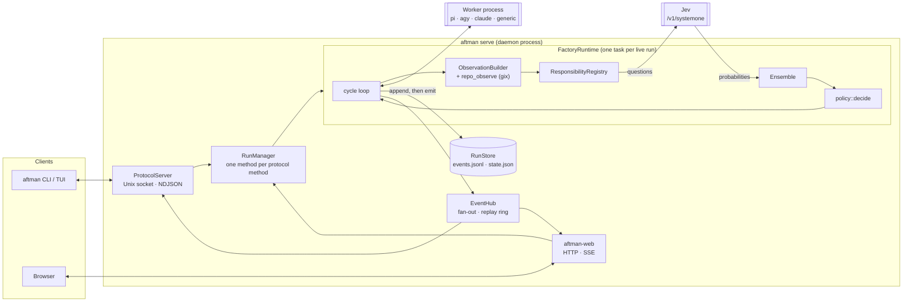

The daemon holds very little logic of its own. `RunManager` starts runs and routes control
messages to them. Each live run is one `FactoryRuntime::drive` task. The `EventHub` fans events
out to subscribers. All the *thinking* happens in `aftman-core`, which the runtime calls.

### 4.2 Starting a run

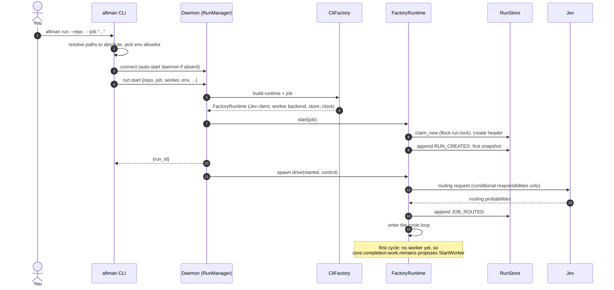

A bad repository fails at `start`, before any run state exists. Once `start` returns, the run is
persisted, addressable, and owned. From the start of `start` until `drive` returns, the process
driving the run holds an exclusive `flock` on `run.lock`, so there is never a moment when a run
directory exists but nobody owns it.

**Routing** happens once, before the first worker. Most responsibilities are `always = true`. The
*conditional* ones (today only `quality.documentation`) are all evaluated in one Jev request
against the job text alone, never the repository. Routing chooses *which checks take part*. It
never chooses a directive.

### 4.3 The state machine

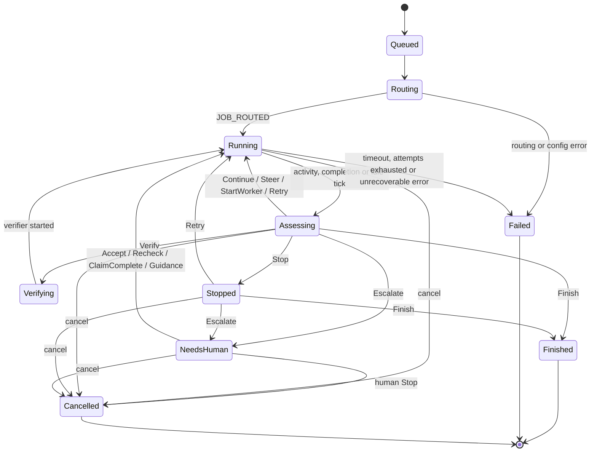

Things this diagram encodes that are easy to get wrong:

- **`Stopped` is not terminal.** `Stop` ends the current *worker*, not the run. On the next cycle
  `core.completion:retry-stopped` may propose `Retry`. A run reaches `Failed` only when its
  attempt budget is spent, its overall timeout passes, or an unrecoverable error occurs.
- **There is no special "start the first worker" step.** The first cycle sees no worker and no
  finished work, so `core.completion:work-remains` proposes `StartWorker`. That passes through
  policy like every other directive.
- **`NeedsHuman` is a wait, but only if something can answer.** With a control channel attached
  (the daemon), the run parks: no cycles, no model calls. Time spent parked does **not** count
  against the overall timeout. With no channel (`--no-daemon`), `NeedsHuman` ends the run with the
  question recorded.
- **Cancel works from every non-terminal state.**
- All transitions go through one `transition()` function with an explicit legal-transition
  table. An illegal transition panics in debug builds and is recorded as an `ERROR` event in
  release builds.

### 4.4 How a run ends: no worker outlives its run

Every path that ends a worker goes through one `stop_worker` function: cancel, `Stop`, supersede
on `Retry`, run end, error, and the daemon shutting down. It calls `Worker::terminate`, re-issues
it every 50 ms until the worker task reports back, aborts the task after 30 s, and only then
flushes final output and records the end. A new worker never starts before the old one has been
reaped.

---

## 5. One supervision cycle

### 5.1 What wakes the loop

A cycle is not triggered by events in the log. The log is the cycle's *output*. Instead, the run
loop selects over four sources:

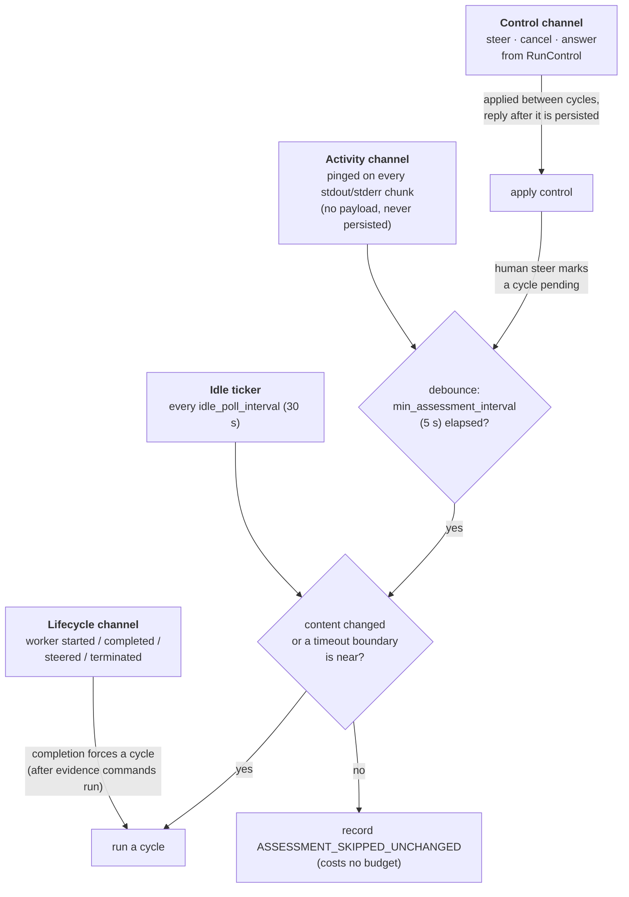

The design is easiest to follow through the bugs it prevents:

- **Two intervals, not one.** The debounce (5 s) limits how often a *chatty* worker is
  assessed. The idle ticker (30 s) makes sure a *silent* worker still gets supervised. A single
  5 s ticker would let a silent worker burn the 400-assessment budget long before its own
  timeout.
- **Skip unchanged.** An idle tick runs a cycle only if the observation's content digest changed
  (BLAKE3 over the observation with timestamps, durations and sequence numbers removed), or if a
  time-based boundary such as a timeout is about to trip. The digest includes the worker's output
  head and tail, so a worker that *says* something new gets assessed.
- **Completion and control are drained at the top of every iteration**, not only when waiting.
  An integration test once found a deadlock: a cycle that outlasted the idle interval meant the
  wait branch never ran, so the loop never saw the worker complete, and the runtime went on
  supervising a process that no longer existed.

### 5.2 The cycle itself

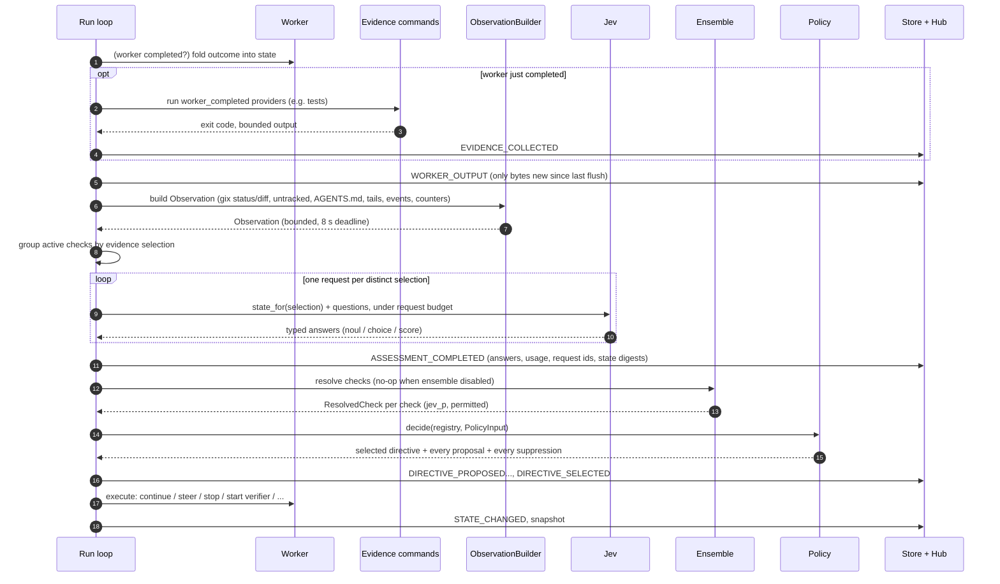

Two properties hold for every cycle:

- **The result is persisted before observation resumes.** A crash never leaves an action with no
  record.
- **Aftman's own events never feed back into the trigger queue**, so the observer cannot trigger
  itself.

---

## 6. Evidence: what aftman looks at

### 6.1 The observation

An `Observation` is compact and bounded on purpose. Every field that reaches a model has a cap
(hard rule 5):

| Evidence | Default bound |
| --- | --- |
| The job prompt | capped, never dropped |
| Most recent worker's output | 4,000-char head + 12,000-char tail, terminal control sequences stripped |
| Worktree diff | 20,000 chars, plus a git-shaped `--stat` (256 KiB cap) |
| Untracked files | 3 files, 4,096 bytes total; binaries, symlinks, `.env`, keys, `*secret*`, `*token*` skipped |
| Repository instructions | root `AGENTS.override.md` / `AGENTS.md`, bounded, read fresh, **never persisted** |
| Recent events | last 30, as summaries with **no payload text** |
| Worker history | last 10 workers |
| Test summaries | parsed from worker output (a *claim*) and from command output (a *fact*) |
| Counters | attempts, failures, verifiers, steers, assessments, elapsed |

**Claims versus facts.** A worker that prints `3 passed` has made a claim. A configured command
provider that runs `pytest -q` and records its exit code has produced a fact. Results from each
source are tagged with it (`source: worker_output` or `source: command`), and checks are written to
weight the two differently. The only way a claim becomes a fact is through command evidence
providers:

```toml
[[evidence.commands]]
id = "tests"
argv = ["pytest", "-q"]            # a literal argv, never a shell string
run_when = "worker_completed"      # worker_completed | on_demand | before_finish
timeout_seconds = 600
max_output_bytes = 20000
```

A `before_finish` provider is the main defence against a worker that reports tests it never ran.
Before a `Finish` is allowed, the provider runs and the cycle is assessed again with its output
visible to every check the `Finish` rule reads.

Stored command output is **dropped whenever a new worker starts**, because it measured a tree
that worker may change.

### 6.2 Reading the repository without running anything it names

The repository is controlled by the worker. A `git` subprocess would execute programs that the
repository's own configuration names: clean/smudge filters, `core.fsmonitor`, hooks, diff
drivers, textconv. A worker could use that to get code run by the unrestricted supervisor.
So the observation is computed **in-process with `gix`**, with an empty filter and diff-driver
list (`crates/aftman-daemon/src/repo_observe.rs`). Worktree files are opened
`O_NONBLOCK | O_NOFOLLOW`, regular files only, with byte caps applied while reading. The whole read
has one 8 s deadline. If the read fails, that cycle's repository evidence is omitted, an
`observation_note` says why, and the `UnobservedRepository` invariant stops a `Finish` from
treating "could not read" as "nothing changed".

### 6.3 From observation to model input

`Observation::state_for(providers)` is **the only place evidence becomes model input**. It is
deterministic: the same observation and the same provider selection produce byte-identical JSON.
With a single choke point, both the request budget and the prompt-injection surface can be
audited in one place.

---

## 7. From probabilities to proposals

### 7.1 Jev, briefly

Jev answers typed questions about a JSON `state`. It has three primitives:

| Primitive | Returns | Example |
| --- | --- | --- |
| **Noul** | P(statement is true), `0.0–1.0` | `worker_stuck = 0.88` |
| **Choice** | one category, a probability per category, a confidence | — |
| **Score** | an expected position on an ordered rubric, with per-level probabilities | — |

Jev fits this job for two reasons. The answers are typed, so there is no prose to parse. And many
independent questions can share one observation in a single request, so adding a check does not
lengthen a generated answer.

`aftman-jev` validates every answer strictly. A requested key that is missing is a `ModelError`.
So is a `Noul` outside `[0,1]`, a `Choice` outside its criteria, or a requested key answered with a
type this client does not model. Answers that were never asked for are ignored. A malformed
answer is never silently clamped into a usable one.

### 7.2 Grouping and the request budget

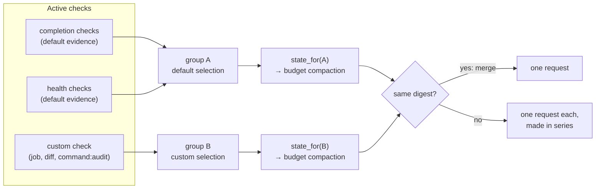

- Checks are grouped by **which evidence they select**. Each group becomes one Jev request. If
  two groups' states are byte-identical, they are merged into one request. The bundled
  definitions usually make one request per cycle.
- **All or nothing.** If the assessment budget cannot cover every request in a cycle, none is
  made. If any request fails, the cycle has no answers, and policy sees an empty check set, which
  allows only conservative directives.
- **The request budget** shrinks the state deterministically when it is too large: oldest events
  go first, then old worker history, then extra untracked files, then the middle of the diff.
  Long strings are cut *from the middle* and marked `…[truncated N bytes]…`, so the model never
  sees a silently clipped fact. The job, the status, the active worker's tail, the prior
  decision and the counters are never dropped. If those alone exceed the budget, the result is
  `BudgetExceeded`, which becomes an `Escalate`.
- Every request appends a line to `jev-usage.jsonl`, *before* the answer is validated, so a
  malformed response still shows up in the bill.

### 7.3 Responsibilities, checks and rules

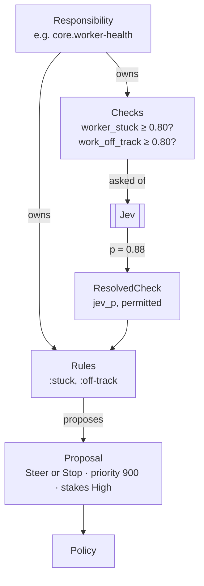

Responsibilities are TOML, compiled in with `include_str!` and overridable from
`$XDG_CONFIG_HOME/aftman/responsibilities/`. Adding a check or a responsibility needs no code.
Adding a new *directive source* needs code and a priority, on purpose: directive sources are
where a mistake can stop someone else's work.

The bundled set:

| Responsibility | Checks (threshold) | Proposes |
| --- | --- | --- |
| `core.completion` | `implementation_complete`, `requirements_satisfied`, `ready_to_finish` (0.75) | `Retry` after a stop (800), `Finish` (700), `StartWorker` when work remains (500) |
| `core.verification` | `tests_sufficient` (0.75), `needs_verification` (0.65) | `Verify` (600) |
| `core.worker-health` | `meaningful_progress`, `worker_stuck` (0.80), `work_off_track` (0.80) | `Steer` or `Stop` (900) |
| `repository.instructions` | `agents_md_drift` (0.80) | `Steer` or `Stop` (900) |
| `core.human-escalation` | `needs_human` (0.80) | `Escalate` (1000) |
| `quality.documentation` *(conditional)* | `documentation_sufficient` (0.75) | `StartWorker` when below (750) |

A rule's `when` is a small boolean grammar over check results (`>=`, `>`, `<=`, `<`, `and`, `or`,
`not`), parsed into a `Condition` tree.

**Steer or stop** is a deterministic decision, not a model output:

```text
Steer  if  steering enabled  and  the backend supports steering
           and  supervisor steers to this worker < max_steers_per_worker (1)
           and  not within the 30 s steering grace window
Stop   otherwise
```

So a backend that cannot take mid-turn input degrades to stop-and-retry with the same
thresholds. This is why a backend's `supports_steering` must be honest.

---

## 8. Policy: the only thing that decides

### 8.1 Pure by construction

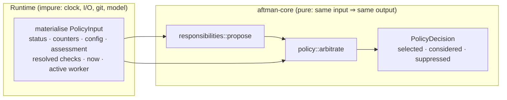

Policy reads no clock, does no I/O, and uses no randomness. The current time is *passed in*
(`PolicyInput::now`). Every collection that reaches policy is ordered (`BTreeMap`, `Vec`, never
`HashMap`), so serialisation is byte-stable. Together these make a run **replayable**: give
policy the same input reconstructed from the log, and it produces the same decision.

### 8.2 Two phases: invariants, then priority

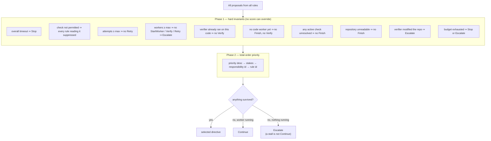

The priority table (authoritative copy in
[05-responsibilities.md §6.3](05-responsibilities.md)):

```text
1000  Escalate     core.human-escalation:needs-human
 950  Escalate     runtime:budget-exhausted
 900  Stop/Steer   core.worker-health:stuck · :off-track · repository.instructions:drift
 850  Escalate     core.ensemble:escalate
 800  Retry        core.completion:retry-stopped
 750  StartWorker  quality.documentation:insufficient
 700  Finish       core.completion:thresholds-satisfied
 600  Verify       core.verification:warranted · :required
 500  StartWorker  core.completion:work-remains
   0  Continue     runtime:default
```

Every rule has a unique id, so the tie-break is a **total order**. No two proposals ever compare
equal, so the winner never depends on iteration order.

`DIRECTIVE_SELECTED` records every proposal and every suppression with its reason, so "why
didn't it stop?" can be answered from the log alone.

### 8.3 What it takes to finish

`Finish` is the one directive that cannot be undone, so it has the strictest precondition:

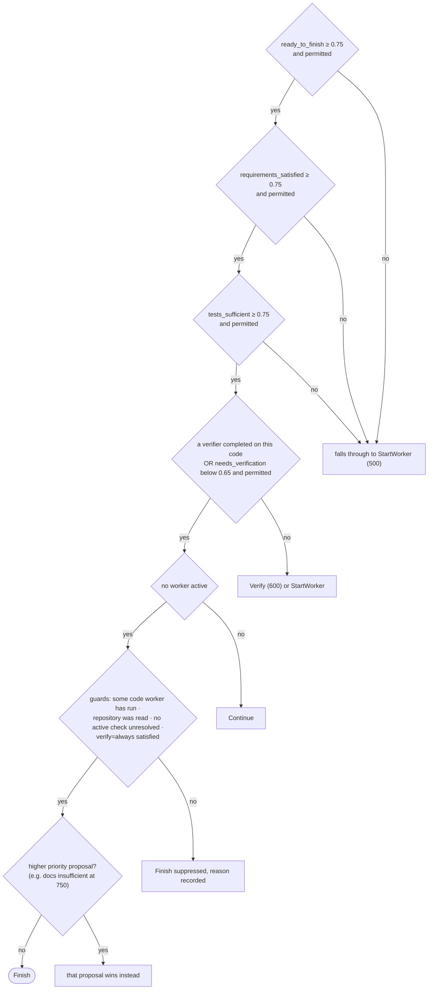

Some of these guards exist because a test or a live run found a way through without them:

- **No code worker has run yet ⇒ no `Finish`.** A test model once answered optimistically on the
  very first cycle and "finished" a job before any work existed.
- **Uncertainty about a blocker must block.** `quality.documentation:insufficient` (750) outranks
  `Finish` (700). If the documentation check is too uncertain to fire, its inhibition would quietly
  disappear and `Finish` would go through. So *any* unresolved active check suppresses `Finish`.
- **The worker limit does not disarm an inhibitor.** If a higher-priority proposal asking for work
  is refused only because `max_workers` is reached, `Finish` is refused too, and the run escalates
  and names the rule. "No worker left" does not mean "nothing left to do".
- **Verification "completed" is not "passed".** A verifier that reports FAIL completes. Its report
  is the most recent worker output, so `ready_to_finish`, scored over that report, carries the
  failure.

### 8.4 When the model fails

A model error is never a reason to guess. Policy gets an empty check set and can choose only
from a short list: `Continue` while a worker is active, `Retry` only if an earlier cycle already
established that work remained, `Escalate` with reason `model_unavailable` after three
consecutive failures or when the budget is spent, and `Stop` on timeout. The UI shows this as
"supervision is blind", which is a different message from "the model thinks a human is needed".

---

## 9. The ensemble: honest uncertainty

The ensemble is **off by default**. With it off, a rule fires at exactly `p ≥ t`, and none of this
section has any effect. With it on, it addresses one problem: `ready_to_finish = 0.79` against a
threshold of `0.75` is "yes", `0.71` is "no", and the model is not accurate to `0.02`.

### 9.1 The rule that makes it safe

> **Nothing a model produces can enable a directive.** Only Jev's own value, decisively outside
> the uncertainty band, or a fresh value from a deterministic evidence refresh can enable one.
> Opinions and in-band values can only *suppress*.

Concretely:

- Jev's number is **never modified**. Opinions are never averaged with it, and no ε is added.
- Each check carries a boolean **`permitted = decisive && !contested`**, where
  `decisive = |p − t| ≥ margin` (default margin 0.15).
- An opinion can set `permitted` from true to false. **No operation in the type system can turn
  false into true.**
- `permitted` does not encode a direction (it is *not* `p ≥ t`), so `<` rules work like `>=`
  rules.

The short version operators remember: **opinions can stop work; only evidence can finish it.**

### 9.2 The ladder

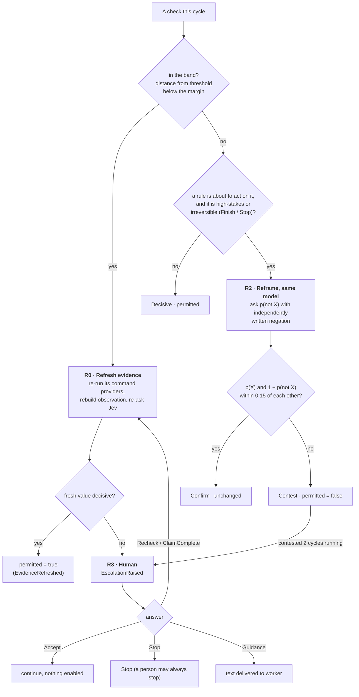

Notes:

- **In-band checks never get a model opinion.** An in-band check is never permitted, so neither
  Confirm nor Contest could change the outcome. Calling a model there would cost money for a
  guaranteed no-op. The only thing that can resolve an in-band check is fresh *evidence* (R0),
  or else a person.
- **R2 is a consistency check, not a second estimate.** `(p + (1 − p¬)) / 2` is never computed.
  Agreement is evidence about *reliability*. Disagreement suppresses.
- **R1, an independent cross-model judge with no tools, is designed but refused until stage S3
  (M7).**
- **A human answer is an authorisation, not a probability.** `ClaimComplete` does not satisfy a
  `Finish` conjunct. It triggers R0, and the fresh value then has to clear the precondition by
  itself.
- Everything is budgeted (`max_opinions_per_run`, per-check refresh caps, cooldowns) and recorded
  (`ENSEMBLE_TRIGGERED`, `OPINION_RECORDED`, `ENSEMBLE_RESOLVED`). `RecordedOpinionSource` can
  rebuild the resolution bit for bit from the log.

---

## 10. Workers

### 10.1 One small trait

```rust
#[async_trait]
pub trait Worker: Send + Sync {
    fn kind(&self) -> WorkerKind;
    fn supports_steering(&self) -> bool;
    async fn run(&self, ctx: WorkerCtx, emit: WorkerEventSink) -> Result<WorkerOutcome>;
    async fn steer(&self, message: &str) -> Result<SteerOutcome>;   // Delivered | Queued | Rejected | Unsupported
    async fn terminate(&self, reason: TerminateReason) -> Result<()>;
}
```

| Backend | Transport | Live steering |
| --- | --- | --- |
| `pi` | `pi --print --mode json` (one-shot), or `pi --mode rpc` | Yes over RPC, but only after `aftman doctor --probe-workers` has verified RPC mode on this machine |
| `agy` | `agy --print=… --output-format stream-json` | No |
| `claude` | `claude -p --output-format stream-json` | No |
| `generic` | an operator-supplied argv template (`{mission_file}`) | No |
| `herdr-pane` | drives a herdr agent pane (planned, M6) | Yes |
| `simulated` | in-process, for tests and `aftman demo` | Yes |

### 10.2 Process discipline

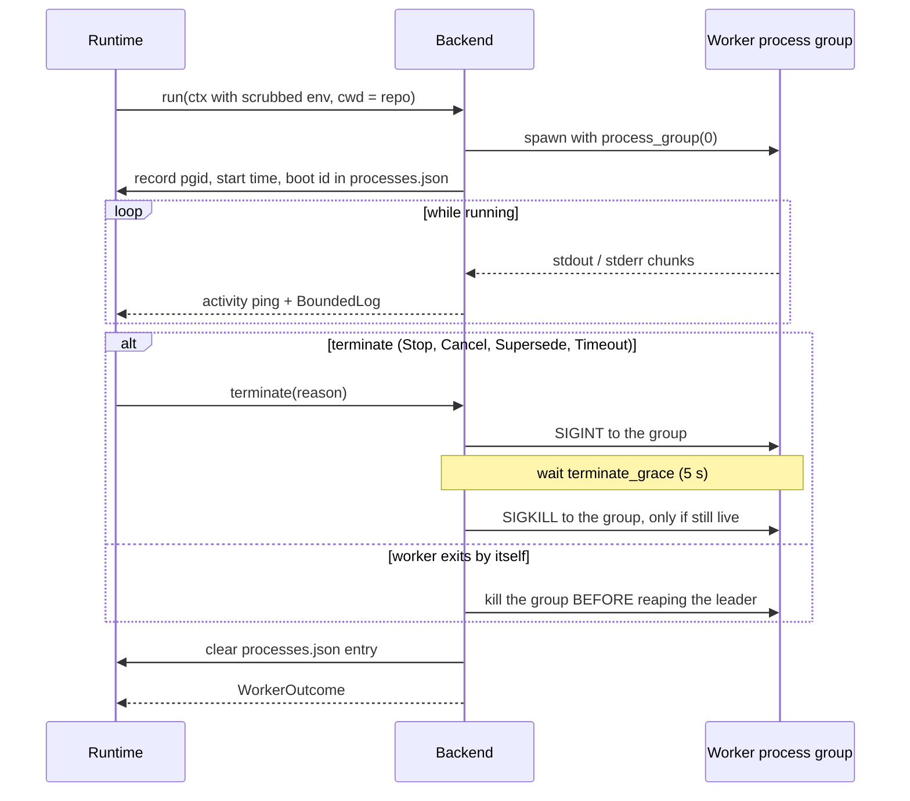

- **Its own process group.** Coding agents spawn shells, test runners and language servers, so a
  kill has to reach the whole tree. The group is ended **whenever the worker exits**, not only
  when it is terminated, because a background helper left running could otherwise go on writing
  to the repository after aftman had judged it. On Linux the exit is awaited with
  `waitid(WNOWAIT)`, so the group id cannot be reused before the kill.
- **Orphans after a crash.** If the daemon is `kill -9`'d, workers survive in their own groups.
  On restart, recovery reads `processes.json` and signals a group **only if it can positively
  identify it**: same pid, same start time, same process group, same boot. Anything it cannot
  identify is reported and left alone.
- **Bounded output.** Every stream goes into a ring buffer, so a worker cannot exhaust daemon
  memory by printing. Output reaches the log as one `WORKER_OUTPUT` event per cycle, not one per
  line, which keeps the log proportional to decisions rather than to how much the agent talks.

### 10.3 The verifier is just a worker

Verification is not a special code path. It is the same `Worker` trait with a fixed mission:
*"You are an independent verifier… try to falsify the claim that the job is complete… Do not
modify the repository."* Its rules:

- It must use a **different backend** from the coder.
- It runs at most once per state of the code. A later code worker resets that, so a FAIL, a fix
  and a PASS can still finish.
- **A verifier that modifies the repository is a policy violation.** The runtime fingerprints the
  tree before the verifier starts and after it ends. If the tree changed, the verification is
  inconclusive, it is *not* retried, and the run escalates with a question naming what changed.

---

## 11. Persistence and the event stream

### 11.1 On disk

```text
$XDG_STATE_HOME/aftman/                 (default ~/.local/state/aftman, mode 0700)
├─ runs/<run-id>/
│  ├─ events.jsonl          append-only, one EventEnvelope per line
│  ├─ state.json            full snapshot, written by atomic rename
│  ├─ run.lock              flock held by whichever process drives the run
│  ├─ processes.json        worker process groups launched and not yet reaped
│  └─ artifacts/
├─ jev-usage.jsonl          one line per model request
└─ verified-streams.json    launch shapes a live probe unlocked (0600)
```

- **Events are immutable.** Corrections are new events. Each envelope has a per-run monotonic
  `seq` starting at 1, and a `schema_version` in its payload.
- **`state.json`** records the last `seq` it includes. On load it is checked against the tail of
  the log, and a mismatch that cannot be explained means aftman refuses to continue rather than
  guess.
- **Torn tails are repaired.** A crash in the middle of an append leaves at most a fragment on the
  last line, which the next append truncates. It never leaves corruption in the middle of the log.
- **One writer per run**, enforced by `flock`. The kernel releases the lock if the process dies,
  so there is no stale-lock cleanup to do. This is how a restarted daemon avoids marking `Failed`
  a run that is alive under `--no-daemon` in another terminal.

### 11.2 Gap-free streaming: append, then emit

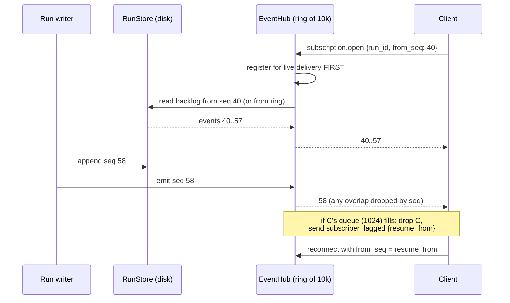

The exactly-once, in-order guarantee rests on one rule that **every** writer of a run's events
follows: *append to the store before emitting to the hub, in `seq` order, with none skipped.*
A writer that broke it would create a gap that no client could detect. For the same reason, a
future that contains an `emit`, or one that runs a command provider, is never dropped
mid-flight (never placed under a `timeout` or a losing `select!` branch).

A slow client can never stall a run. Its bounded queue overflows, it is dropped with a
`subscriber_lagged` push that says where to resume, and it reconnects.

---

## 12. The daemon and the surfaces

### 12.1 One protocol, several transports

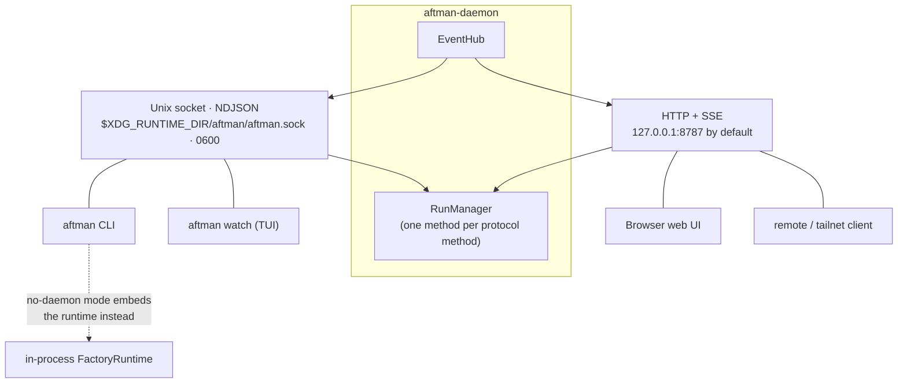

- **The socket is the real API.** It speaks NDJSON with one JSON object per line: requests carry
  an `id`, responses echo it, and event pushes have none. You can debug it with `nc`. Methods
  include `run.start`, `run.list`, `run.get`, `run.events`, `subscription.open`, `run.steer`,
  `run.cancel`, `run.answer`, `run.purge`, and `daemon.status`.
- **HTTP is a second transport over the same `RunManager`**, so a rule enforced for one is
  enforced for both. SSE event ids are `seq` values, so a browser reconnecting with
  `Last-Event-ID` resumes exactly.
- **Every input is bounded and strict.** Params reject unknown fields, and there are caps on
  request lines (1 MiB), jobs (256 KiB), steers (16 KiB), and forwarded environment entries. A
  connection limit, outbound queue, write timeout and idle timeout stop any single client from
  hurting a run or locking out `aftman stop`.

### 12.2 The daemon's own lifecycle

- **Auto-start.** The first command that needs run state connects to the socket. If no daemon
  is there, it spawns `aftman serve --detached`, which calls `setsid()` before any thread exists
  (the workspace forbids `unsafe`, so there is no double fork) and then `chdir("/")`. The client
  makes every path absolute before sending it.
- **The daemon's environment is frozen, so each run brings its own.** The client forwards an
  allowlist of its own environment (`PATH`, `VIRTUAL_ENV`, `SSH_AUTH_SOCK`, … plus
  `--pass-env`). The daemon adds only a fixed baseline (`HOME`, `PATH`, locale, `XDG_*`). Anything
  else the daemon happens to hold, such as a `GITHUB_TOKEN` exported in the shell that started
  it, does not reach workers.
- **Single instance.** One daemon per socket (a `flock` on the pid file) and one per state
  directory (`daemon.lock`).
- **Restart recovery.** A run with no `RUN_FINISHED`, a non-terminal status, and a claim nobody
  holds is an orphan. It is marked `Failed` ("daemon restarted") by appending events that continue
  its `seq`. Resuming runs is not implemented, so the only outcomes are "someone is driving it" or
  `Failed`, and there are no silent zombies.
- **Graceful shutdown.** Stop accepting connections, cancel every live run (each is persisted
  `Cancelled`), give stragglers up to 60 s before aborting them (recorded `Failed`), flush every
  subscriber its final events, then remove the socket and pid file, but only if they are still the
  files this daemon created.

### 12.3 What surfaces cannot do

- **No surface can enable `Finish`.** A human can answer an *escalation*, which policy then
  consumes. There is no path from a click to a probability. "This is complete" means "re-measure",
  not "finish".
- **A human steer does not skip the loop.** It is recorded as a human steer, marks a cycle pending
  under the normal debounce, opens the steering-grace window, and does not use up the supervisor's
  steer budget.
- **A human may always stop work**, from any surface.

---

## 13. Trust boundaries and security

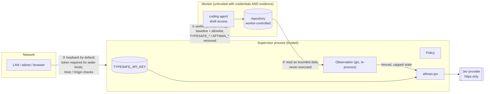

The three boundaries:

1. **Supervisor ↔ worker.** A coding agent is a general-purpose program with a shell. If it
   could read the supervisor's key, any prompt injection reaching it could exfiltrate a billable
   credential. So every subprocess aftman spawns gets its environment from
   `worker_environment()`, built from a fixed baseline plus the run's forwarded allowlist. The one
   documented exception is the daemon re-executing *itself* during auto-start
   (`crates/aftman-cli/src/autostart.rs`).
2. **Evidence ↔ model.** Repository prose, including `AGENTS.md`, can contain text addressed to
   a model. Everything that reaches Jev is bounded, labelled by source, and passed as *data* in
   the `state` object. Jev gets typed questions, not instructions from the repository. The worst
   realistic outcome of an injection is a *worse judgment*, which thresholds, invariants and the
   ensemble exist to limit. Repository observation runs no program the repository names (§6.2).
3. **Network ↔ daemon.** HTTP is loopback-only by default. Any non-loopback bind without
   `auth = "token"` is a **startup error**, not a warning. `Host` and `Origin` checks block DNS
   rebinding and cross-site form posts. Repository paths from the web are canonicalised and must
   lie inside `allowed_repo_roots`.

Other credential rules: `<repo>/.env` is **never** loaded into the supervisor. Otherwise a cloned
repository could set `TYPESAFE_BASE_URL` to an attacker's host and collect the key. A cleartext
non-loopback base URL is refused at startup.

**What aftman does not protect against**, stated plainly in [08-security.md §10](08-security.md):
a destructive worker (aftman is *not a sandbox*, so use a container or a throwaway checkout), a
malicious repository's influence on the *agent*, a compromised agent binary, multi-user
isolation, and a confidently wrong judgment.

Untrusted text on its way to *your terminal* (worker output, job text, daemon errors) goes
through one choke point, `crates/aftman-cli/src/out.rs` and `sanitize.rs`. In the web UI it goes
through one HTML escaper.

---

## 14. Determinism, replay and testing

The design has to stay testable offline at every layer. The default test suite runs with **no
network, no credentials, and no real agent binary**:
`env -i PATH="$PATH" HOME="$HOME" cargo test --workspace`.

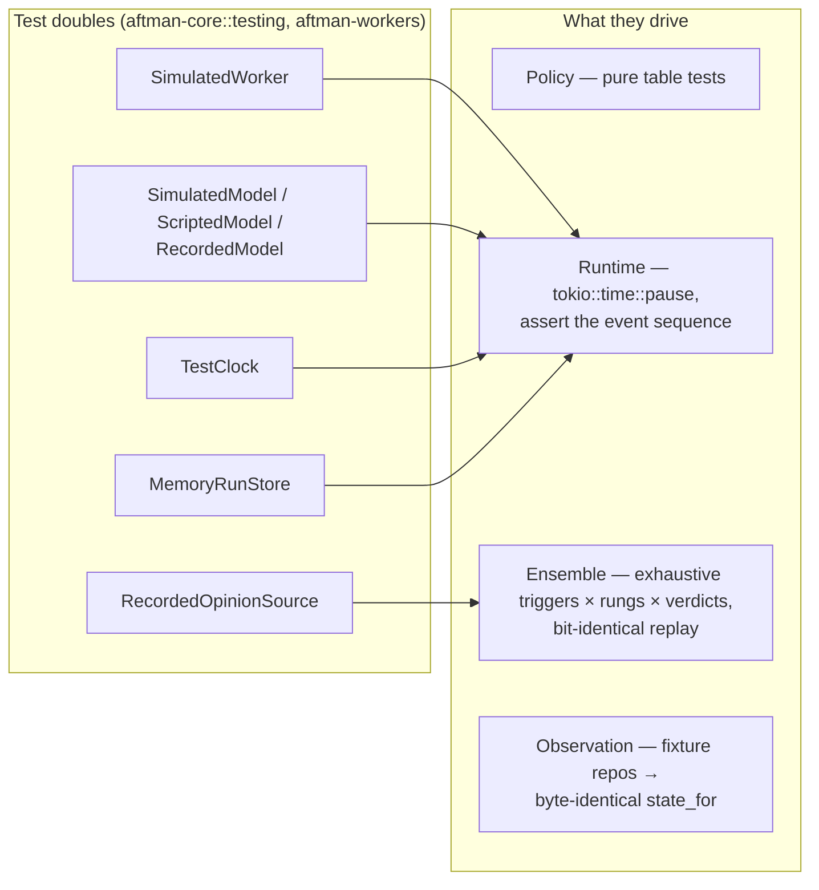

What makes this possible:

- An **injected `Clock`** is the only source of time. Elapsed time uses `tokio::time::Instant`.
- **Policy is pure**, and all impurity is confined to building `PolicyInput`.
- **Ordered collections everywhere**, so serialisation is byte-stable.
- **Every model answer, usage record, state digest and opinion is persisted**, so a run's
  decisions can be recomputed from its log.
- Live tests against a real Jev or a real agent are `#[ignore]`d and gated behind `AFTMAN_LIVE=1`.
  [10-live-validation.md](10-live-validation.md) is the runbook for the first real exercise.

---

## 15. What is built today

From [09-plan.md](09-plan.md), at the time of writing:

| Milestone | Status |
| --- | --- |
| M0 skeleton and offline run · M1 real Jev · M2 responsibilities, policy, real worker | complete |
| M3 daemon, protocol, CLI, TUI · M4 web UI | complete |
| M5 ensemble S1 + S2 (R0 refresh, R2 reframe, R3 human) | complete |
| M6 herdr (`herdr:pane` backend, notifications) | not started |
| M7 ensemble S3 + S4 (R1 independent judge, escalation timeout) | not started |
| M8 backend hardening, in-process repository observation | in progress |

Configuration reality check: of the `config.toml` tables described in
[02-lld.md §12](02-lld.md), only `[web]` and `[ensemble]` are read today. The other tables are
designed but **refused if present**, so a setting cannot be silently ignored. The other defaults
come from compiled constants.

---

## 16. Where to go from here

| Question | Doc | Code |
| --- | --- | --- |
| What exactly is in a type? | [02-lld.md §3](02-lld.md) | `crates/aftman-core/src/` |
| How does the run loop work? | [02-lld.md §6–7](02-lld.md) | `crates/aftman-daemon/src/runtime.rs` (`drive_inner`) |
| How is evidence gathered? | [05-responsibilities.md §3–4](05-responsibilities.md) | `crates/aftman-daemon/src/obs.rs`, `repo_observe.rs` |
| How is a Jev request built and bounded? | [03-jev.md](03-jev.md) | `crates/aftman-jev/src/client.rs`, `budget.rs` |
| Why did policy pick this directive? | [05-responsibilities.md §6](05-responsibilities.md) | `crates/aftman-core/src/policy.rs` |
| How are checks and rules defined? | [05-responsibilities.md §1–2](05-responsibilities.md) | `crates/aftman-core/src/definitions.rs`, `condition.rs`, `responsibility.rs` |
| What does the ensemble do? | [06-ensemble.md](06-ensemble.md) | `crates/aftman-core/src/ensemble/` |
| How does a backend spawn and kill an agent? | [04-workers.md](04-workers.md) | `crates/aftman-workers/src/subprocess.rs`, `backends.rs` |
| How are events stored and streamed? | [02-lld.md §8, §11](02-lld.md) | `crates/aftman-store/src/file.rs`, `crates/aftman-daemon/src/hub.rs` |
| What does the wire protocol look like? | [02-lld.md §11](02-lld.md) | `crates/aftman-daemon/src/protocol.rs`, `server.rs`, `manager.rs` |
| How is the binary wired together? | [07-surfaces.md §1](07-surfaces.md) | `crates/aftman-cli/src/factory.rs`, `autostart.rs` |
| What is the security posture? | [08-security.md](08-security.md) | `crates/aftman-workers/src/lib.rs` (`worker_environment`), `crates/aftman-web/src/auth.rs` |

To see it all work with nothing real involved, run `aftman demo` (simulated worker, simulated
model, no network). For any real run, `aftman decisions <run>` prints every proposal,
suppression and opinion. It is the quickest way to connect this document to what actually
happened.
